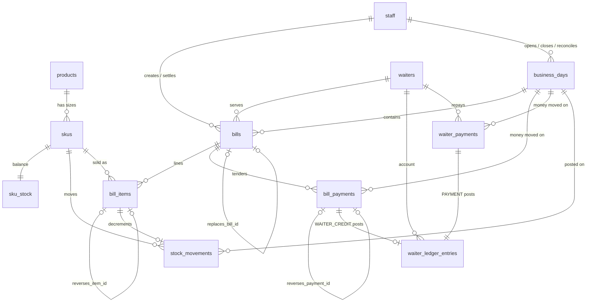
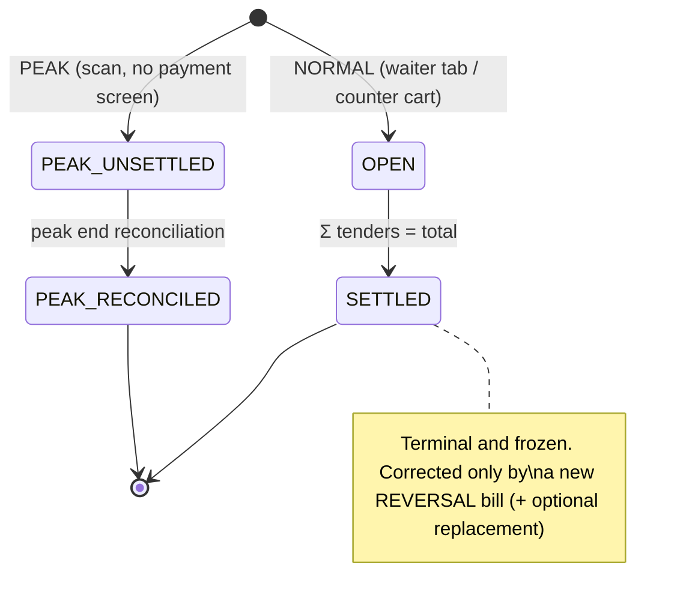

# FL2 POS — Phase 1 Core Schema (Inventory · Waiters · Business Day · Billing)

> **Status:** APPROVED 2026-10-14 and implemented in `migrations/0001_core_schema.sql` + `migrations/0002_core_rules.sql`.
>
> **Decisions applied on approval (these supersede the draft text below where they differ):**
> - **Sizes:** `size_code IN ('FULL','HALF','QUARTER','BEER_650','BEER_330')`. They are labels only, with no volume column.
> - **Multiple peak windows per day:** the `peak_*` columns moved off `business_days` into a child table, **`peak_sessions`**, with the same fields plus `session_no`. At most one session runs at a time. Peak bills carry `peak_session_id`. CASH/UPI tenders and waiter repayments are stamped with the running session's id when they are inserted, so reconciliation works off that id rather than clock windows.
> - **Bill-on-bill:** untrusted waiters can never use a `WAITER_CREDIT` tender. A bill closes only when the CASH/UPI tenders exactly equal the total.
> - **Stock can't go negative:** `CHECK (on_hand_qty >= 0)` plus a `PS003` error raised before any sale or adjustment that would overdraw.
> - **Q1, Q5–Q9:** the defaults were accepted (BIGINT, running waiter account, counter-only peak, single outlet, no discounts).
> - **Error codes:** custom SQLSTATEs `PS001`–`PS009` (see `src/db/errors.ts`).
> - Requires **PostgreSQL 18+** (`uuidv7()`).
> - **Phase 2 amendment (`migrations/0003_waiter_tagging.sql`, pending sign-off):** `bills.waiter_id` may be set or changed on an OPEN, NORMAL-mode SALE bill until the bill's first tender. The trust snapshot is retaken at tagging. Peak bills stay counter-only, and a waiter tag can't be removed. All other bill columns remain immutable.
> **Scope:** Whole-bottle MVP. Covers the Inventory, Waiters, Business Day and Billing domains, plus two small supporting tables (`staff`, `sync_outbox`) that those domains reference.
> **Out of scope:** KOT/printing, members/KYC, purchase orders, expenses, F.Ac.2 reporting. Columns that will point at those later are marked *(future FK)*.

---

## 0. Conventions (apply to every table)

| Concern | Rule | Rationale |
|---|---|---|
| **Primary keys** | `UUID` generated locally (UUIDv7 preferred, so keys sort by time). | The local PostgreSQL is the primary. IDs must be unique everywhere before they reach the cloud, with no central sequence. |
| **Money** | `BIGINT` whole **paise** (₹1 = 100). Column suffix `_paise`. No `NUMERIC`, `REAL` or `DOUBLE`. | Integer maths only. `INTEGER` would cap at ₹2.14 crore, which day and month aggregates can reach. See Open Question Q1. |
| **Quantities** | `INTEGER` whole sealed bottles. Column suffix `_qty`. | No ml, pegs or open bottles. |
| **Signed amounts** | Reversal and refund rows hold **negative** values. Sums over a table give the net position directly. | Makes append-only reversal records possible. |
| **Enums** | `TEXT` + `CHECK (col IN (...))`, mirrored as TS string-literal unions. | Simpler to evolve than `CREATE TYPE ... AS ENUM` (no `ALTER TYPE` migrations). |
| **Timestamps** | `TIMESTAMPTZ`, default `now()`. | |
| **Business date** | `DATE` on `business_days` only. Every transaction references `business_day_id`. | Bars trade past midnight. A 01:30 sale belongs to the previous trading day. |
| **Naming** | `snake_case`, plural table names, FK = `<singular>_id`. | |
| **Deletes** | **Forbidden** on every transactional table (trigger + `REVOKE DELETE` from the app role). | CLAUDE.md: no destructive DB ops. |
| **Master data** | `skus`, `products`, `waiters` and `staff` are never deleted. They are retired with `is_active = false`. | Old bills keep their FKs valid. |

### Table classification

| Class | Tables | UPDATE allowed? | DELETE allowed? |
|---|---|---|---|
| Master (mutable) | `products`, `skus`, `waiters`, `staff` | Yes (`updated_at` maintained) | No |
| Ledger (strict append-only) | `stock_movements`, `bill_items`, `bill_payments`, `waiter_ledger_entries`, `waiter_payments` | **No** | No |
| Lifecycle (append + guarded transitions) | `bills`, `business_days` | Only the state transitions listed below, **until a terminal state is reached**. After that the row is frozen. | No |
| Derived cache | `sku_stock`, `waiters.outstanding_balance` | Only by trigger | No |
| Sync | `sync_outbox` | Only `synced_at` / `attempts` / `last_error` | No |

---

## 1. Entity-Relationship Overview



---

## 2. Supporting Tables

### 2.1 `staff`
Counter and management users (cashier, manager). Waiters are a separate table, as requested.

| Column | Type | Null | Default | Notes |
|---|---|---|---|---|
| `id` | UUID | NO | | PK |
| `display_name` | TEXT | NO | | |
| `role` | TEXT | NO | | `CHECK IN ('CASHIER','MANAGER','ADMIN')` |
| `pin_hash` | TEXT | YES | | Counter login PIN (hashed) |
| `is_active` | BOOLEAN | NO | `true` | |
| `created_at` / `updated_at` | TIMESTAMPTZ | NO | `now()` | |

### 2.2 `sync_outbox`
Transactional outbox. **Every** insert or allowed update to a domain table writes an outbox row **in the same DB transaction**. A background worker pushes the rows to the cloud.

| Column | Type | Null | Default | Notes |
|---|---|---|---|---|
| `seq` | BIGSERIAL | NO | | PK. Local, gap-tolerant delivery order |
| `event_id` | UUID | NO | | `UNIQUE`. Idempotency key for the cloud |
| `aggregate_type` | TEXT | NO | | e.g. `bill`, `business_day`, `waiter`, `sku` |
| `aggregate_id` | UUID | NO | | |
| `event_type` | TEXT | NO | | e.g. `bill.settled`, `bill.reversed`, `peak.ended` |
| `payload` | JSONB | NO | | Money stays as integer paise in the JSON |
| `created_at` | TIMESTAMPTZ | NO | `now()` | |
| `synced_at` | TIMESTAMPTZ | YES | | Set by the worker on cloud ack |
| `attempts` | INTEGER | NO | `0` | |
| `last_error` | TEXT | YES | | |

Index: `(synced_at) WHERE synced_at IS NULL` for the pending-queue scan.

---

## 3. Inventory Domain

**Design:** `products` (brand family) → `skus` (one row per sealed bottle size) → `stock_movements` (append-only ledger) → `sku_stock` (cached balance, trigger-maintained).
**No column stores ml, volume, pegs or open-bottle state.**

### 3.1 `products`
Groups the size SKUs of one brand, for brand-level reports and the menu grid.

| Column | Type | Null | Default | Notes |
|---|---|---|---|---|
| `id` | UUID | NO | | PK |
| `name` | TEXT | NO | | e.g. "Old Monk XXX Rum". `UNIQUE (lower(name))` |
| `category` | TEXT | NO | | e.g. `WHISKY`, `RUM`, `VODKA`, `BEER`, `WINE`, `BRANDY`, `GIN`, `OTHER` (CHECK list) |
| `is_active` | BOOLEAN | NO | `true` | |
| `created_at` / `updated_at` | TIMESTAMPTZ | NO | `now()` | |

### 3.2 `skus`
One row per **sellable sealed bottle size**. Full, Half and Quarter of the same brand are three separate SKUs.

| Column | Type | Null | Default | Notes |
|---|---|---|---|---|
| `id` | UUID | NO | | PK |
| `product_id` | UUID | NO | | FK → `products.id` |
| `sku_code` | TEXT | NO | | `UNIQUE`. Short human code for keyboard entry (e.g. `OMR-F`) |
| `barcode` | TEXT | YES | | `UNIQUE` where not null. Scanner input |
| `size_code` | TEXT | NO | | `CHECK IN ('FULL','HALF','QUARTER')`. A **label only**, with no ml value attached (see Q2) |
| `display_name` | TEXT | NO | | e.g. "Old Monk XXX Rum — Half" |
| `price_paise` | BIGINT | NO | | Current selling price. `CHECK (price_paise > 0)` |
| `is_active` | BOOLEAN | NO | `true` | |
| `created_at` / `updated_at` | TIMESTAMPTZ | NO | `now()` | |

Constraints: `UNIQUE (product_id, size_code)`.
Price changes are plain updates. History is preserved because every `bill_items` row snapshots the price at the time of sale.

### 3.3 `stock_movements` (append-only ledger)
The single source of truth for stock. Each row is a signed whole-bottle delta.

| Column | Type | Null | Default | Notes |
|---|---|---|---|---|
| `id` | UUID | NO | | PK |
| `sku_id` | UUID | NO | | FK → `skus.id` |
| `business_day_id` | UUID | YES | | FK → `business_days.id`. Null only for `OPENING` loaded before the first day |
| `movement_type` | TEXT | NO | | See table below |
| `qty_delta` | INTEGER | NO | | `CHECK (qty_delta <> 0)`. Sign enforced per type |
| `bill_item_id` | UUID | YES | | FK → `bill_items.id`. `UNIQUE`, so each bill line moves stock at most once |
| `source_ref_type` | TEXT | YES | | e.g. `PURCHASE_ORDER` *(future)* |
| `source_ref_id` | UUID | YES | | *(future FK)* to the PO, GRN, etc. |
| `reason` | TEXT | YES | | Required for `ADJUSTMENT` |
| `created_by_staff_id` | UUID | YES | | FK → `staff.id` |
| `created_at` | TIMESTAMPTZ | NO | `now()` | |

| `movement_type` | Sign | Created by |
|---|---|---|
| `OPENING` | + | Initial stock load |
| `PURCHASE_RECEIPT` | + | Goods received *(PO module, later)* |
| `SALE` | − | Trigger on a positive `bill_items` row |
| `SALE_REVERSAL` | + | Trigger on a negative `bill_items` row where `restock = true` |
| `ADJUSTMENT` | ± | Manager: breakage, physical-count correction. `reason` required |

CHECKs:
- `(movement_type IN ('SALE') AND qty_delta < 0) OR (movement_type IN ('OPENING','PURCHASE_RECEIPT','SALE_REVERSAL') AND qty_delta > 0) OR movement_type = 'ADJUSTMENT'`
- `movement_type IN ('SALE','SALE_REVERSAL') ⇔ bill_item_id IS NOT NULL`

Indexes: `(sku_id, created_at)`, `(business_day_id)`.

### 3.4 `sku_stock` (derived cache)
| Column | Type | Null | Default | Notes |
|---|---|---|---|---|
| `sku_id` | UUID | NO | | PK, FK → `skus.id` |
| `on_hand_qty` | INTEGER | NO | `0` | `= SUM(stock_movements.qty_delta)` for the SKU |
| `updated_at` | TIMESTAMPTZ | NO | `now()` | |

Maintained only by an `AFTER INSERT` trigger on `stock_movements`. The app never writes it directly.
**Invariant (testable):** `sku_stock.on_hand_qty = SUM(stock_movements.qty_delta) GROUP BY sku_id`.
Negative on-hand: see Q6. The proposal is to **allow it and raise a warning** rather than block a sale at the counter during peak.

---

## 4. Waiters Domain

**Design:** `waiters.outstanding_balance` is a cached figure derived from an append-only `waiter_ledger_entries` table. Cash or UPI that a waiter hands over is recorded in `waiter_payments`.

### 4.1 `waiters`
| Column | Type | Null | Default | Notes |
|---|---|---|---|---|
| `id` | UUID | NO | | PK |
| `waiter_code` | TEXT | NO | | `UNIQUE`. Short code for the Captain app and counter |
| `display_name` | TEXT | NO | | |
| `phone` | TEXT | YES | | |
| `pin_hash` | TEXT | YES | | Captain app login |
| **`is_trusted`** | BOOLEAN | NO | `false` | `true` allows collect-later (credit) and partial payment. `false` means strict bill-on-bill |
| **`outstanding_balance`** | BIGINT | NO | `0` | **Paise** the waiter owes the house. `CHECK (outstanding_balance >= 0)`. Trigger-maintained, never written by the app |
| `credit_limit_paise` | BIGINT | YES | | *Proposed addition.* Null = no limit. `CHECK (credit_limit_paise IS NULL OR credit_limit_paise >= 0)` |
| `is_active` | BOOLEAN | NO | `true` | |
| `created_at` / `updated_at` | TIMESTAMPTZ | NO | `now()` | |

Rules:
- Turning `is_trusted` off does **not** wipe an existing balance. The waiter must pay it down, and no new credit is allowed.
- **Invariant (testable):** `outstanding_balance = SUM(waiter_ledger_entries.amount_paise)` for the waiter.

### 4.2 `waiter_ledger_entries` (append-only)
The waiter's running account. A positive amount means the waiter owes more. A negative amount means the waiter owes less.

| Column | Type | Null | Default | Notes |
|---|---|---|---|---|
| `id` | UUID | NO | | PK |
| `waiter_id` | UUID | NO | | FK → `waiters.id` |
| `business_day_id` | UUID | NO | | FK → `business_days.id` |
| `entry_type` | TEXT | NO | | See below |
| `amount_paise` | BIGINT | NO | | `CHECK (amount_paise <> 0)`. Sign enforced per type |
| `balance_after_paise` | BIGINT | NO | | Snapshot set by trigger, for waiter statements |
| `bill_payment_id` | UUID | YES | | FK → `bill_payments.id` (credit tenders). `UNIQUE` |
| `waiter_payment_id` | UUID | YES | | FK → `waiter_payments.id`. `UNIQUE` |
| `reason` | TEXT | YES | | Required for `MANUAL_ADJUSTMENT` |
| `created_by_staff_id` | UUID | YES | | FK → `staff.id` |
| `created_at` | TIMESTAMPTZ | NO | `now()` | |

| `entry_type` | Sign | Source |
|---|---|---|
| `BILL_CREDIT` | + | `bill_payments` row with `tender_type = 'WAITER_CREDIT'` and amount > 0 |
| `BILL_CREDIT_REVERSAL` | − | Reversal of a `WAITER_CREDIT` tender (voided bill) |
| `PAYMENT` | − | `waiter_payments` row with amount > 0 |
| `PAYMENT_REVERSAL` | + | `waiter_payments` reversal row (mis-keyed repayment) |
| `MANUAL_ADJUSTMENT` | ± | Manager write-off or correction. `reason` required |

The `AFTER INSERT` trigger does `UPDATE waiters SET outstanding_balance = outstanding_balance + NEW.amount_paise` and then fills `balance_after_paise`. `CHECK (outstanding_balance >= 0)` rejects overpayment.

### 4.3 `waiter_payments` (append-only)
Money a waiter hands to the counter against their outstanding balance. This is separate from paying a specific bill.

| Column | Type | Null | Default | Notes |
|---|---|---|---|---|
| `id` | UUID | NO | | PK |
| `waiter_id` | UUID | NO | | FK → `waiters.id` |
| `business_day_id` | UUID | NO | | FK → `business_days.id` |
| `tender_type` | TEXT | NO | | `CHECK IN ('CASH','UPI')` |
| `amount_paise` | BIGINT | NO | | `CHECK (amount_paise <> 0)`. Negative only when `reverses_waiter_payment_id` is set |
| `reverses_waiter_payment_id` | UUID | YES | | FK → self. `UNIQUE` |
| `upi_ref` | TEXT | YES | | UTR / txn ref |
| `received_by_staff_id` | UUID | NO | | FK → `staff.id` |
| `created_at` | TIMESTAMPTZ | NO | `now()` | |

CHECK: `(amount_paise > 0 AND reverses_waiter_payment_id IS NULL) OR (amount_paise < 0 AND reverses_waiter_payment_id IS NOT NULL)`.
Each row produces exactly one `waiter_ledger_entries` row in the same transaction.
The proposal is a **running account**: repayments reduce the overall balance and are not allocated to individual bills (see Q5).

---

## 5. Business Day Domain

### 5.1 `business_days`
| Column | Type | Null | Default | Notes |
|---|---|---|---|---|
| `id` | UUID | NO | | PK |
| `business_date` | DATE | NO | | `UNIQUE`. The trading date, not the calendar date |
| `status` | TEXT | NO | `'OPEN'` | `CHECK IN ('OPEN','CLOSED')` |
| `next_bill_no` | INTEGER | NO | `1` | Bill-number counter. Taken with `SELECT ... FOR UPDATE` |
| `opened_at` | TIMESTAMPTZ | NO | `now()` | |
| `opened_by_staff_id` | UUID | NO | | FK → `staff.id` |
| `closed_at` | TIMESTAMPTZ | YES | | |
| `closed_by_staff_id` | UUID | YES | | FK → `staff.id` |
| **Peak window** | | | | |
| `peak_started_at` | TIMESTAMPTZ | YES | | |
| `peak_started_by_staff_id` | UUID | YES | | FK → `staff.id` |
| **`peak_start_cash`** | BIGINT | YES | | Paise counted in the drawer at peak start. `CHECK (>= 0)` |
| **`peak_start_upi`** | BIGINT | YES | | Paise shown as the UPI collection total (QR/soundbox dashboard) at peak start. `CHECK (>= 0)` |
| `peak_ended_at` | TIMESTAMPTZ | YES | | |
| `peak_ended_by_staff_id` | UUID | YES | | FK → `staff.id` |
| **`peak_end_cash`** | BIGINT | YES | | Paise counted in the drawer at peak end. `CHECK (>= 0)` |
| **`peak_end_upi`** | BIGINT | YES | | UPI collection total at peak end. `CHECK (>= 0)` |
| `peak_expected_paise` | BIGINT | YES | | *Proposed addition.* Frozen snapshot of the expected collection (§7) at peak end |
| `peak_variance_paise` | BIGINT | YES | | *Proposed addition.* Frozen `actual − expected`. Negative means a shortage |

Constraints:
- One open day at a time: `UNIQUE INDEX ON business_days ((true)) WHERE status = 'OPEN'`.
- Peak start fields go together: `(peak_started_at IS NULL) = (peak_start_cash IS NULL) AND (peak_started_at IS NULL) = (peak_start_upi IS NULL) AND (peak_started_at IS NULL) = (peak_started_by_staff_id IS NULL)`.
- Peak end fields go together, and so do `peak_ended_at`, `peak_end_cash`, `peak_end_upi`, `peak_expected_paise`, `peak_variance_paise` and `peak_ended_by_staff_id`.
- `peak_ended_at IS NULL OR (peak_started_at IS NOT NULL AND peak_ended_at >= peak_started_at)`.
- `status = 'CLOSED' ⇒ closed_at IS NOT NULL AND closed_by_staff_id IS NOT NULL AND (peak_started_at IS NULL OR peak_ended_at IS NOT NULL)`.

Guarded transitions (enforced by trigger):

| From | To | Allowed changes |
|---|---|---|
| OPEN, no peak | OPEN, peak running | Set the four `peak_start*` fields |
| OPEN, peak running | OPEN, peak ended | Set the `peak_end*`, expected and variance fields. The **same transaction** moves all of that day's `PEAK_UNSETTLED` bills to `PEAK_RECONCILED` |
| OPEN | CLOSED | Rejected if any bill on the day is `OPEN` or `PEAK_UNSETTLED` |
| Any | — | Once set, peak fields are frozen. A `CLOSED` row is fully frozen. `next_bill_no` only increments while `OPEN` |

> One peak window per day follows the requested shape. If you need several windows (e.g. a lunch rush and a night rush), these columns move into a child table `peak_sessions` with the same fields. See Q3.

---

## 6. Billing Domain

### 6.1 Modes vs states
The requested "Normal" and "Peak_Unsettled" are split into two orthogonal columns:

- **`billing_mode`** — `NORMAL` or `PEAK`. Fixed when the bill is created.
- **`status`** — lifecycle state. `PEAK_UNSETTLED` is one of the values.



| `billing_mode` | Allowed `status` values | Has tenders? |
|---|---|---|
| `NORMAL` | `OPEN` → `SETTLED` | Yes. `Σ bill_payments = total_paise` at settlement |
| `PEAK` | `PEAK_UNSETTLED` → `PEAK_RECONCILED` | **No.** The money is accounted for at business-day level (§7) |

### 6.2 `bills`
| Column | Type | Null | Default | Notes |
|---|---|---|---|---|
| `id` | UUID | NO | | PK |
| `business_day_id` | UUID | NO | | FK → `business_days.id` |
| `bill_no` | INTEGER | NO | | From `business_days.next_bill_no`. `UNIQUE (business_day_id, bill_no)`. Printed as `YYYYMMDD-NNNN` |
| `bill_kind` | TEXT | NO | `'SALE'` | `CHECK IN ('SALE','REVERSAL')` |
| `billing_mode` | TEXT | NO | | `CHECK IN ('NORMAL','PEAK')` |
| `status` | TEXT | NO | | `CHECK IN ('OPEN','SETTLED','PEAK_UNSETTLED','PEAK_RECONCILED')` |
| `source` | TEXT | NO | | `CHECK IN ('COUNTER','WAITER_APP')` |
| `waiter_id` | UUID | YES | | FK → `waiters.id`. Null for counter walk-in bills |
| `waiter_trusted_at_billing` | BOOLEAN | YES | | Snapshot of `waiters.is_trusted` at creation (audit: why credit was allowed) |
| `member_id` | UUID | YES | | *(future FK → members)*. Optional. **No KYC gate** |
| `total_paise` | BIGINT | NO | `0` | `= Σ bill_items.line_total_paise`. ≥ 0 for SALE, ≤ 0 for REVERSAL |
| `reverses_bill_id` | UUID | YES | | FK → `bills.id`. `UNIQUE`, so a bill can be reversed at most once |
| `replaces_bill_id` | UUID | YES | | FK → `bills.id`. `UNIQUE`. Set on the corrected replacement bill and points at the reversed original |
| `reversal_reason` | TEXT | YES | | Required when `bill_kind = 'REVERSAL'` |
| `created_by_staff_id` | UUID | YES | | FK → `staff.id` (null if created from the waiter app) |
| `created_at` | TIMESTAMPTZ | NO | `now()` | |
| `settled_at` | TIMESTAMPTZ | YES | | Set on → `SETTLED` |
| `settled_by_staff_id` | UUID | YES | | FK → `staff.id` |
| `peak_reconciled_at` | TIMESTAMPTZ | YES | | Set on → `PEAK_RECONCILED` |

CHECK constraints:
1. Mode/status pairing: `(billing_mode = 'NORMAL' AND status IN ('OPEN','SETTLED')) OR (billing_mode = 'PEAK' AND status IN ('PEAK_UNSETTLED','PEAK_RECONCILED'))`
2. Peak bills are counter-only: `billing_mode = 'NORMAL' OR (source = 'COUNTER' AND waiter_id IS NULL)` (see Q7)
3. Reversal shape: `(bill_kind = 'REVERSAL') = (reverses_bill_id IS NOT NULL)` and `bill_kind = 'SALE' OR reversal_reason IS NOT NULL`
4. Sign: `(bill_kind = 'SALE' AND total_paise >= 0) OR (bill_kind = 'REVERSAL' AND total_paise <= 0)`
5. No self-reference: `reverses_bill_id <> id`, `replaces_bill_id <> id`
6. `replaces_bill_id IS NULL OR bill_kind = 'SALE'`
7. Settlement metadata: `status <> 'SETTLED' OR settled_at IS NOT NULL`. `status <> 'PEAK_RECONCILED' OR peak_reconciled_at IS NOT NULL`

Trigger-enforced rules:
- **Frozen after terminal state.** Once `status IN ('SETTLED','PEAK_RECONCILED')`, any `UPDATE` raises. Before that, only `status`, `total_paise`, `settled_*`, `peak_reconciled_at` and `member_id` may change.
- A `PEAK` bill may only be inserted while its business day has `peak_started_at` set and `peak_ended_at` null.
- A `REVERSAL` bill cannot itself be reversed. Its `reverses_bill_id` target must be `SETTLED`, `PEAK_UNSETTLED` or `PEAK_RECONCILED`. An `OPEN` bill is corrected with line cancellations, not with a reversal bill.
- `replaces_bill_id` may only point at a bill that already has a reversal.
- **Deferred constraint trigger at COMMIT:** `total_paise = Σ bill_items.line_total_paise`, and for `SETTLED` bills, `Σ bill_payments.amount_paise = total_paise`.

Indexes: `(business_day_id, status)`, `(waiter_id, status)`, `(business_day_id, billing_mode)`, `(created_at)`.

#### Reversal mechanism (no DELETE, no edit of settled rows)
- **Void:** insert a new `bills` row with `bill_kind = 'REVERSAL'` and `reverses_bill_id = <original>`. Its lines are the original lines with negated `qty`, its total is negated, and its tenders are negated (refunds). The original row is never touched. "Is voided" is derived from `EXISTS (reversal where reverses_bill_id = original.id)`.
- **Correction:** the void above, plus a new `SALE` bill with `replaces_bill_id = <original>`. Partial returns are handled the same way (full reversal, then a re-bill of what was kept). This keeps every bill as a clean, self-consistent document.
- **Posting date:** a reversal goes on the **currently open** business day, not the original's day. Closed days stay frozen.
- **Mode of the reversal:**
  - Original is `PEAK_UNSETTLED` in the **currently running** peak → the reversal is `PEAK` / `PEAK_UNSETTLED`, with no tenders. It lowers the peak's expected collection.
  - Any other case → the reversal is `NORMAL` / `SETTLED`, with refund tenders (cash or UPI out, or a waiter-credit reversal).
- **Convenience view:** `v_bills_effective` lists SALE bills that have no reversal. Reports read from this view.

### 6.3 `bill_items` (append-only)
| Column | Type | Null | Default | Notes |
|---|---|---|---|---|
| `id` | UUID | NO | | PK |
| `bill_id` | UUID | NO | | FK → `bills.id` |
| `line_no` | INTEGER | NO | | `UNIQUE (bill_id, line_no)` |
| `sku_id` | UUID | NO | | FK → `skus.id` |
| `sku_code_snapshot` | TEXT | NO | | Frozen at sale |
| `display_name_snapshot` | TEXT | NO | | Frozen at sale |
| `size_code_snapshot` | TEXT | NO | | `FULL` / `HALF` / `QUARTER` |
| `qty` | INTEGER | NO | | Whole bottles. `CHECK (qty <> 0)` |
| `unit_price_paise` | BIGINT | NO | | Price snapshot. `CHECK (unit_price_paise >= 0)` |
| `line_total_paise` | BIGINT | NO | | `GENERATED ALWAYS AS (qty * unit_price_paise) STORED` |
| `reverses_item_id` | UUID | YES | | FK → `bill_items.id`. Set on every negative line |
| `restock` | BOOLEAN | NO | `true` | Only meaningful on negative lines. `false` = bottle not returned sealed, so no stock comes back |
| `waiter_id` | UUID | YES | | FK → `waiters.id`. Who added the line (waiter app) |
| `created_by_staff_id` | UUID | YES | | FK → `staff.id` |
| `created_at` | TIMESTAMPTZ | NO | `now()` | |

CHECK: `(qty > 0 AND reverses_item_id IS NULL) OR (qty < 0 AND reverses_item_id IS NOT NULL)`.

Rules (trigger):
- **Line cancellation on an `OPEN` bill:** insert a negative line in the **same bill** with `reverses_item_id` pointing at the original line. Lines are never deleted, even before settlement. This preserves an audit trail of items removed after a KOT was sent.
- **On a `REVERSAL` bill:** each negative line's `reverses_item_id` points at a line on the reversed bill.
- The net quantity per original line can never drop below 0: `original.qty + Σ reversing.qty >= 0`.
- No inserts once the parent bill is terminal (`SETTLED` / `PEAK_RECONCILED`).
- The insert trigger writes one `stock_movements` row: `SALE` (−qty) for positive lines, `SALE_REVERSAL` (+|qty|) for negative lines with `restock = true`, and nothing for `restock = false`.

### 6.4 `bill_payments` (append-only tenders)
| Column | Type | Null | Default | Notes |
|---|---|---|---|---|
| `id` | UUID | NO | | PK |
| `bill_id` | UUID | NO | | FK → `bills.id` |
| `business_day_id` | UUID | NO | | FK → `business_days.id`. The day the money actually moved |
| `tender_type` | TEXT | NO | | `CHECK IN ('CASH','UPI','WAITER_CREDIT')` |
| `amount_paise` | BIGINT | NO | | `CHECK (amount_paise <> 0)`. Negative = refund or reversal |
| `reverses_payment_id` | UUID | YES | | FK → `bill_payments.id`. `UNIQUE` |
| `upi_ref` | TEXT | YES | | |
| `received_by_staff_id` | UUID | YES | | FK → `staff.id` |
| `created_at` | TIMESTAMPTZ | NO | `now()` | |

CHECK: `(amount_paise > 0 AND reverses_payment_id IS NULL) OR (amount_paise < 0 AND reverses_payment_id IS NOT NULL)`.

Rules (trigger):
- Payments only attach to `NORMAL` bills. Positive payments only go on `SALE` bills in `OPEN` status, and negative payments only on `REVERSAL` bills.
- **`WAITER_CREDIT` requires** `bills.waiter_id IS NOT NULL` and `waiters.is_trusted = true` at insert time. It also requires `outstanding_balance + amount <= credit_limit_paise` when a limit is set.
- **Untrusted waiters:** only `CASH` / `UPI` are allowed. Split tenders (part cash, part UPI) are fine, but the bill cannot reach `SETTLED` until the cash and UPI rows cover the total.
- Each `WAITER_CREDIT` row posts one `waiter_ledger_entries` row (`BILL_CREDIT` / `BILL_CREDIT_REVERSAL`) in the same transaction.
- Σ positive payments on a bill must never exceed `total_paise` (no over-tender stored; change is handed back and not recorded).

> **Edge case:** if a bill paid partly with `WAITER_CREDIT` is voided **after** the waiter has already paid that credit off, reversing the credit would push `outstanding_balance` below 0. That reversal is therefore issued as a `CASH` / `UPI` refund to the waiter instead. The service layer chooses the refund path, and the CHECK guarantees correctness.

---

## 7. Peak Reconciliation Math

During peak, the counter skips the payment screen, so individual peak bills have no tender. The money is checked as a whole across the window `[peak_started_at, peak_ended_at)` of the business day:

```
actual_delta   = (peak_end_cash − peak_start_cash) + (peak_end_upi − peak_start_upi)

expected_delta = Σ bills.total_paise          WHERE billing_mode = 'PEAK'          (incl. negative peak reversals)
               + Σ bill_payments.amount_paise WHERE tender_type IN ('CASH','UPI') AND created_at IN window
               + Σ waiter_payments.amount_paise WHERE created_at IN window

variance       = actual_delta − expected_delta      (negative = shortage, positive = excess)
```

Why the extra terms: waiter-app bills settled in cash or UPI, and waiter repayments made during the window, land in the **same drawer and the same UPI account**. Leaving them out would show up as a false "excess". Only the **combined** cash + UPI variance is meaningful, because peak bills have no tender split. Separate cash and UPI deltas are still shown for information.

`peak_expected_paise` and `peak_variance_paise` are frozen on `business_days` at peak end, so later activity never rewrites a past reconciliation.

**Worked example**

| Item | ₹ | paise |
|---|---|---|
| Start cash / start UPI reading | 5,000.00 / 12,500.00 | 500000 / 1250000 |
| Peak bills (Σ) | 48,200.00 | 4820000 |
| Peak reversal (one Half voided) | −600.00 | −60000 |
| Waiter A settles a normal bill in cash during the window | 1,500.00 | 150000 |
| Waiter B repays balance via UPI during the window | 2,000.00 | 200000 |
| **Expected delta** | **51,100.00** | **5110000** |
| End cash / end UPI reading | 37,800.00 / 30,750.00 | 3780000 / 3075000 |
| **Actual delta** = (3780000−500000) + (3075000−1250000) | **51,050.00** | **5105000** |
| **Variance** | **−50.00 (short)** | **−5000** |

This is the first Vitest target for the "Peak Mode math" requirement in CLAUDE.md.

> **Known gap:** cash paid out of the drawer during peak (expenses, cash drops to the safe) also changes `actual_delta`. When the Expense module lands, its drawer pay-outs inside the window must be added as `− Σ payouts` to `expected_delta`.

---

## 8. Worked Flows

**A. Counter, Normal mode (Scan → F9 Pay).** The cart lives in UI memory. On F9, a single transaction does: lock the day row → take `bill_no` → `INSERT bills (NORMAL, OPEN)` → insert `bill_items` (each one triggers a `SALE` stock movement) → insert `bill_payments` (CASH/UPI) → `UPDATE status = 'SETTLED'` → `INSERT sync_outbox`. The deferred trigger checks that totals and tenders match at commit.

**B. Counter, Peak mode.** On scan completion, a single transaction does: `INSERT bills (PEAK, PEAK_UNSETTLED)` + items + outbox, with no tender rows. At peak end, a single transaction writes the `peak_end_*`, expected and variance fields and bulk-updates that day's `PEAK_UNSETTLED` bills to `PEAK_RECONCILED`.

**C. Trusted waiter, partial payment.** The bill (₹2,400 = 240000) runs `OPEN` while KOT rounds are added. At settlement: `CASH 150000` + `WAITER_CREDIT 90000` → `SETTLED`. The ledger gets `BILL_CREDIT +90000` → outstanding 90000. The next day, the waiter pays ₹900 UPI → `waiter_payments 90000` + ledger `PAYMENT −90000` → outstanding 0. (Vitest target #2.)

**D. Untrusted waiter.** Same as C, except a `WAITER_CREDIT` insert raises. The bill stays `OPEN` until CASH/UPI rows equal the total.

**E. Void a settled bill #42** (2 × Half @ ₹1,200, paid cash). A new bill #57 is created with `REVERSAL`, `reverses_bill_id = #42`, reason "wrong brand". It has a line of qty −2 with `reverses_item_id` set and `restock = true` (stock +2), and a payment of `CASH −240000` with `reverses_payment_id` set. Bill #42 itself is untouched.

**F. Correct #42.** Do E, then create a new SALE bill #58 with `replaces_bill_id = #42`.

---

## 9. Proposed DB-level Safeguards (summary)

1. App DB role: `GRANT SELECT, INSERT, UPDATE`, **no `DELETE`**, on all domain tables. A `BEFORE DELETE` trigger raises as a second line of defence.
2. A `BEFORE UPDATE` trigger on each ledger table always raises.
3. A `BEFORE UPDATE` guard on `bills` and `business_days` enforces the transition tables in §5.1 and §6.2.
4. Derived caches (`sku_stock`, `waiters.outstanding_balance`, `waiters.balance_after_paise`) are written only by triggers.
5. A deferred constraint trigger checks bill total and tender balance at COMMIT.
6. Nightly self-check queries (also usable as Vitest integration assertions) for the invariants in §3.4, §4.1 and §6.2.

**TypeScript note:** `node-postgres` returns `BIGINT` as a string. Register a type parser for OID 20 that converts to `number` and throws unless `Number.isSafeInteger` (safe up to about ₹90 trillion). Money stays a plain integer `number` in TS, and floats are never introduced.

---

## 10. Open Questions — need your decision before migrations

| # | Question | My default if you don't specify |
|---|---|---|
| **Q1** | You wrote "integer" for money. OK to use Postgres `BIGINT` (still an integer, no floats)? Plain `INTEGER` caps at ₹2.14 crore per value. | `BIGINT` everywhere for paise. `INTEGER` for bottle counts. |
| **Q2** | Are `FULL` / `HALF` / `QUARTER` the only sizes? Beer (650 bottle / 500 can), 1 L and 2 L packs would need more `size_code` labels. They stay labels, with no ml column. | Only the three, extendable via CHECK list. |
| **Q3** | One peak window per business day, or several? | One, as specified (columns on `business_days`). |
| **Q4** | "Strict bill-on-bill" for untrusted waiters: does it mean (a) every bill paid in full with no credit, or also (b) the waiter can't open a new bill while a previous one is unpaid? | (a) only. (b) would add a service-layer check. |
| **Q5** | Should waiter repayments be allocated to specific bills, or is a running account enough? | Running account. |
| **Q6** | Should a sale be allowed to drive `on_hand_qty` negative? | Allow it, with a warning or flag. Never block the counter. |
| **Q7** | Can waiter-app bills be in Peak mode, or is Peak counter-only? | Counter-only (CHECK #2 in §6.2). |
| **Q8** | Single outlet per local DB, or multiple outlets syncing to one cloud? | Single outlet. The outlet identity goes in the outbox envelope, not on every row. |
| **Q9** | Any discounts or complimentary bottles in Phase 1? (There is no tax engine, per CLAUDE.md.) | None. Add `discount_paise` later if needed. |
| **Q10** | **`autoAssignBills` (CLAUDE.md compliance section).** I have *not* designed for this. Randomly attaching walk-in bills to members who didn't make the purchase, before generating an excise F.Ac.2 report, could amount to misstating a statutory register. Please confirm with your excise consultant what the register actually requires before we build it. This schema supports only genuine member linkage (`bills.member_id`, set when a member is identified, e.g. F2 at the counter). | Genuine linkage only. |

---

## 11. Next Steps (after approval)

1. SQL migrations for the tables, constraints, triggers and view above.
2. TS domain types plus a `pg` BIGINT parser.
3. Vitest tests **first**, as CLAUDE.md requires: the peak reconciliation maths (§7 example as a fixture), trusted/untrusted waiter payment transitions (§8 C/D), and void and correction flows (§8 E/F).
4. Verify with `npx vitest run` and `npx tsc --noEmit`.
